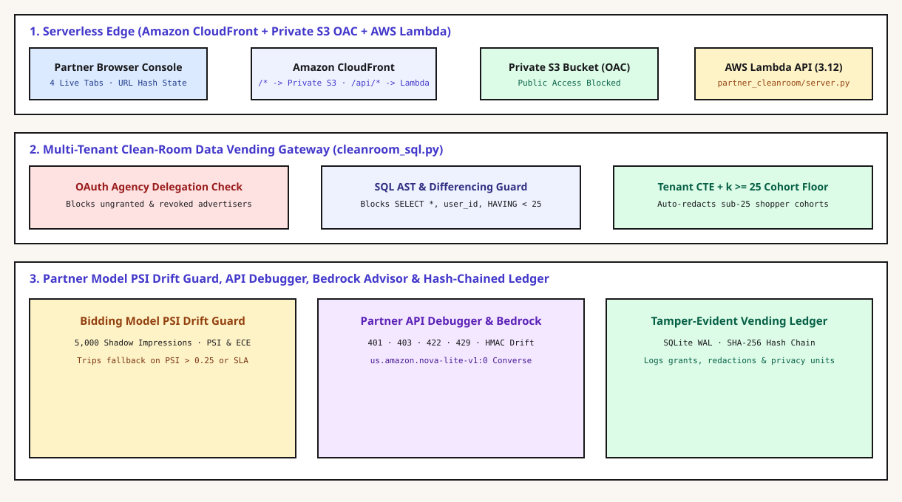

# PartnerCleanRoom: Ads Partner Data Vending Gateway, Model Drift Guard & Bedrock Diagnostics

- **Live CloudFront Application**: https://dwq029a62oitx.cloudfront.net
- **Live `/api/health` Endpoint**: https://dwq029a62oitx.cloudfront.net/api/health
- **GitHub Repository**: https://github.com/ritwikareddykancharla/ads-partner-cleanroom

PartnerCleanRoom is a multi-tenant control plane for advertising agencies and partner integrations, deployed serverlessly on **Amazon CloudFront + Private S3 (OAC) + AWS Lambda (serverless) + SQLite WAL + Amazon Bedrock (`us.amazon.nova-lite-v1:0`)** at `$0.00` idle infrastructure cost.



## 01 · Problem

Advertising agencies and SaaS bidding providers manage dozens of brands simultaneously while querying campaign cohorts, operating custom bidding models, and calling Partner APIs:

1. **Cohort Reconstruction & Shopper Leakage**: Queries using `SELECT *`, `SUBSTR(user_id, 1, 8)`, `EXCEPT` set differencing, or micro-segments below 25 buyers can expose individual shopper identities.
2. **Cross-Tenant Grant Changes**: Agencies hold brand-specific OAuth delegation grants that advertisers can revoke at any moment, requiring immediate query-time isolation.
3. **Partner Bidding Model Drift**: External conversion scorers drift after promotional events (`PSI > 0.25`), lose probability calibration (`ECE > 0.060`), or breach auction tail latency SLAs.
4. **Partner API & Webhook Failures**: Expired Login with Amazon (`LWA`) refresh tokens, missing advertiser profile scopes, float dollar bids sent to `bid_micros` v3 routes, `429 Retry-After` violations, and JSON re-serialization breaking `HMAC-SHA256` webhook signatures stall partner launches.

## 02 · Architecture & Modules

- `partner_cleanroom/cleanroom_sql.py`: Enforces OAuth agency-to-advertiser delegation grants (`agency_id -> advertiser_ids & scopes`), inspects SQL tokens before execution (`0.026 ms` median), binds queries to parameterized tenant CTEs, and injects `COUNT(DISTINCT user_id)` verification to redact every cohort below `k = 25` shoppers (`0.807 ms` median).
- `partner_cleanroom/model_drift.py`: Evaluates partner custom bidding scorers across `5,000` Sponsored Ads shadow impressions per run, computing 10-bin Population Stability Index (`PSI`), 10-bin Expected Calibration Error (`ECE`), Brier score, and 100-impression slate `p99` latency, automatically tripping fallback to `amz-default-calibrated-ecpm-v4`.
- `partner_cleanroom/partner_diagnostics.py`: Diagnoses `401`, `403`, `422`, `429`, and `HMAC` webhook integration errors, retrieves Partner Knowledge Base playbooks, analyzes authorized `k >= 25` campaign cohorts, checks retail ad-policy compliance, and calls Amazon Bedrock (`us.amazon.nova-lite-v1:0`) via the Converse API.
- `partner_cleanroom/vending_ledger.py`: Appends every partner SQL query, `k`-anonymity redaction count, grant revocation, model drift evaluation, and API diagnostic run to a SHA-256 hash-chained SQLite WAL audit database.
- `partner_cleanroom/server.py`: Shared local HTTP server and AWS Lambda Function URL `lambda_handler` serving `/api/health`, `/api/cleanroom/query`, `/api/models/evaluate`, `/api/partner/diagnose`, `/api/audit/verify`, `/api/benchmarks`, and `/api/reset`.

## 03 · Measured Benchmarks (`benchmarks/latest_results.json`)

Measured by `python3 benchmarks/run_benchmarks.py`:

| Metric | Measured Value | Details |
| --- | --- | --- |
| **Red-Team Protection Rate** | `24 / 24` (`100.0%`) | `0.0%` cross-advertiser leaks and `0` sub-25 shopper leaks |
| **SQL Policy Inspection (`p50` / `p95`)** | `0.026 ms` / `0.282 ms` | Pre-execution PII, wildcard, and differencing check |
| **Clean-Room SQL Execution (`p50` / `p95`)** | `0.807 ms` / `1.351 ms` | `76` safe cohorts vended, `24` micro-cohorts redacted (`136` shoppers) |
| **Partner Model Drift Accuracy** | `4 / 4` (`100.0%`) | `5,000` shadow impressions per scenario (`0.035 ms` healthy slate `p99`, `2.0468` drifted `PSI`) |
| **Partner API Diagnostic Accuracy** | `10 / 10` (`100.0%`) | Verified across `401`, `403`, `422`, `429`, and `HMAC` webhook drift |
| **Amazon Bedrock Latency (`p50` / `p95`)** | `994.5 ms` / `1,313.9 ms` | `10` live `us.amazon.nova-lite-v1:0` calls (`669.7` mean tokens, `6,697` total) |
| **SQLite WAL Hash-Chain Verify** | `1.443 ms` | Verified `69` chained rows from `GENESIS_PARTNER_CLEANROOM_0000` |

## 04 · Local Quickstart & Verification

```bash
# Run the 12-test unit suite
python3 -m unittest discover -s tests -v

# Run real SQLite, PSI drift, and live Amazon Bedrock benchmarks
AWS_PROFILE=portfolio AWS_DEFAULT_REGION=us-west-2 python3 benchmarks/run_benchmarks.py

# Start local server at http://localhost:3099
python3 -m partner_cleanroom.server
```
